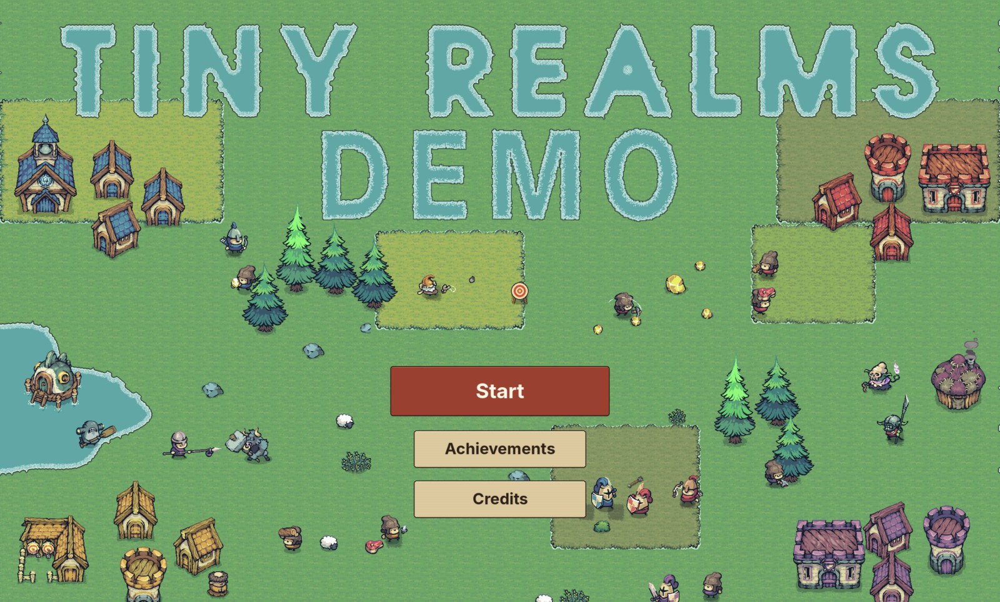
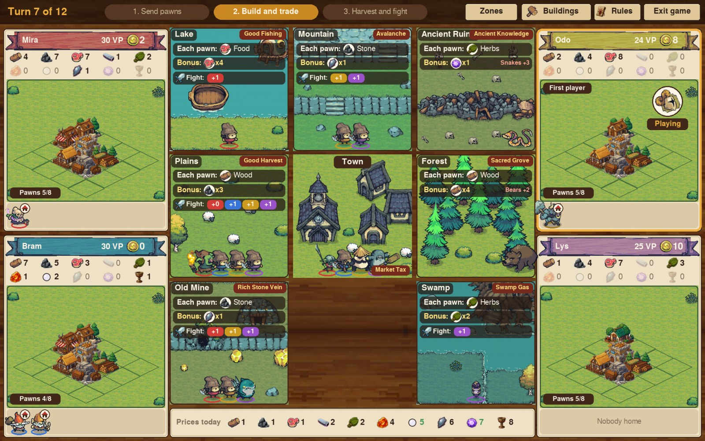
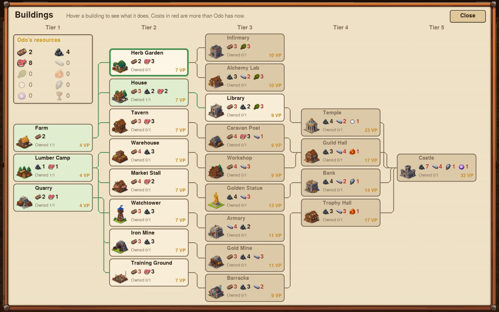
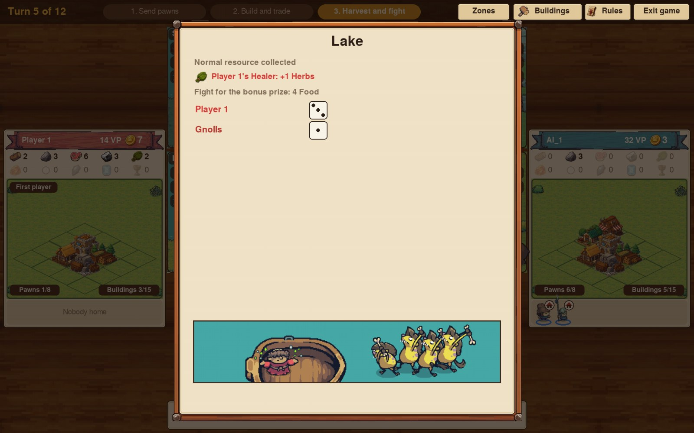

# Tiny Realms — free demo

A board game for 2 to 4 players, humans or computers, by AmauryBioCode, made with Python and pygame-ce.

**Play it in your browser on itch.io: https://amaurybiocode.itch.io/tiny-realms-demo**

This demo has the tutorial and the normal game (8 or 12 turns, 2 to 4 players). The advanced game
(events, factions, monster abilities, challenges) and a better computer player are coming in the
full game.

| | |
|---|---|
|  |  |
| *A game with 4 players: send pawns to the zones, then build and trade.* | *The building tree: 25 buildings in 5 tiers.* |
|  | |
| *Harvest and fight: roll the dice against the mobs for the bonus prize.* | |

## What is in this repository

The game's code and the trained computer players (`trained_ai`). The art, music and sounds are
**not** included: they come from asset packs whose licences don't allow sharing the files. They are
listed in `CREDITS.txt`, with links to each pack. To run the game from this code, get the packs and
put them in an `assets` folder; otherwise, play the demo on itch.io.

## Folders

- `main.py`: starts the game.
- `game/`: the game's code: `app.py` (the window and screens), `engine.py` (the rules), `data.py`
  (pawns, buildings, mobs: change numbers here to rebalance), `ai.py` (the computer players),
  `art.py`, `sound.py`, `tutorial.py`, `achievements.py`, `screen.py`.
- `trained_ai/`: the trained computer players.
- `packaging/`: the recipes to build the browser version and the Mac or Windows program.
- `screenshots/`: the pictures in this page.
- `assets/`: the pictures, music and sounds (not in this repository, see above).

## Run it from the code

- Mac: double-click `play.command` (it installs pygame-ce the first time).
- Any computer with Python 3: `python3 -m pip install pygame-ce`, then `python3 main.py`.

## Build it

- Browser version (itch.io): `python packaging/build_web.py`. It makes `dist/TinyRealms-web.zip`;
  add `--test` to play it at http://localhost:8000 first.
- Mac app or Windows program: `python3 -m pip install pyinstaller pillow`, then
  `pyinstaller packaging/tiny_realms.spec`. The result is in the `dist` folder.

## Licence

© AmauryBioCode. All rights reserved. The code is shared so you can read it; please don't reuse or
redistribute it without asking.
